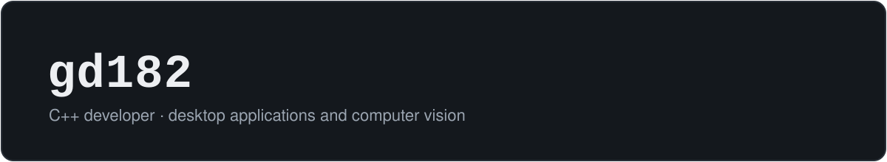

  

  
  

## GD182 — general description

GD182 is a C++ engineer that covers the full path of the data: from the source,
through the desktop app that displays it, to the vision or ML code that makes sense of it.
One part instead of three, no glue logic required.

## Features

- **Desktop:** Qt Widgets / QML / Charts, real-time telemetry, serial and network protocols
- **Vision & ML:** OpenCV pipelines, PyTorch / LibTorch, TensorFlow
- **Core:** C++17/20, STL, Boost, CMake, multithreading
- **Also supported:** embedded (ESP32, FreeRTOS)
- Field-proven: 5+ years in production, 50+ shipped projects
- Builds on Linux. Always.

## Typical applications

| Part | What it does | Stack |
| --- | --- | --- |
| [**MineAI**](https://github.com/gd182/MineAI) | CNN that learns Minesweeper through self-play. Training loop written from scratch; one set of weights plays any board size | C++17, LibTorch, CUDA |
| [**ThreadPool**](https://github.com/gd182/ThreadPool) | Thread pool with priorities, `std::future` results, runtime resizing and exception isolation | C++ |
| [**CookieBot**](https://github.com/gd182/CookieBot) | Game bot driven only by screen capture and input emulation, no access to game code | Python, CV |

Currently in development: a pipeline that turns 3D models into labeled training data,
so detectors can be trained without manual annotation.

## Supported toolchain

  

## Operating notes

- Working software beats clever abstractions.
- Code explains itself; comments explain *why*.
- Ship it, measure it, then make it better.

## Revision history

| Rev | Changes |
| --- | --- |
| 5 (current) | Synthetic dataset generation for vision models. Accepting contracts |
| 1 – 4 | 5 years, 50+ projects: industrial telemetry, desktop tools, firmware, CV pipelines |

## Ordering information

Available for contract work in C++, Qt and computer vision.
Send a request via [Telegram](https://t.me/rkt267).
